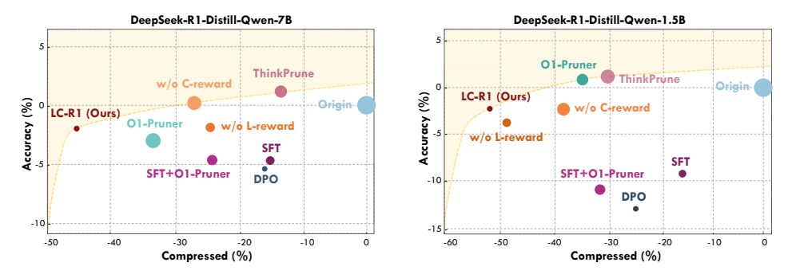
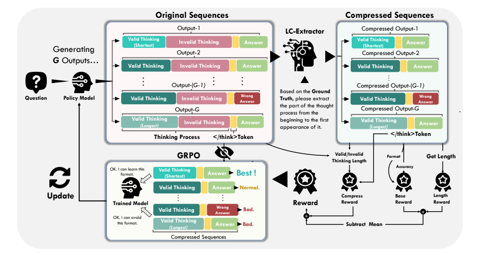
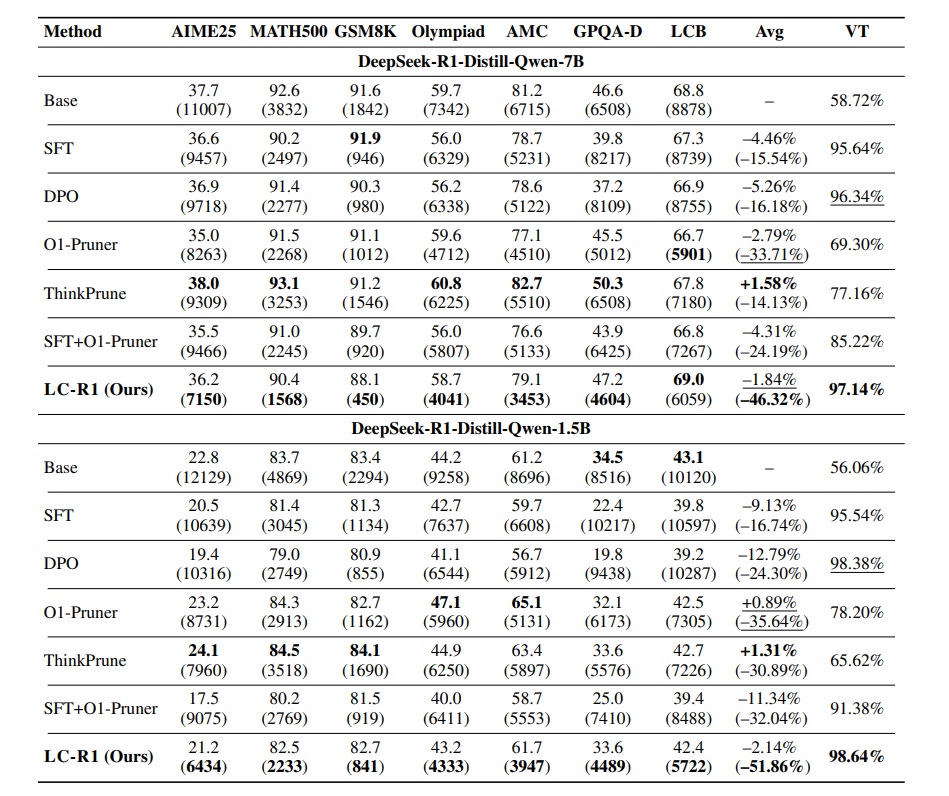

<h1 align="center">Optimización de la compresión de longitud en modelos de razonamiento de gran tamaño</h1>

<p align="center">
<strong><a href="https://arxiv.org/abs/2506.14755">📄Artículo</a> | <a href="https://huggingface.co/collections/zx10086/lc-r1-685a7f3a33f3ba17f2c493b8">🤗Repositorio de modelos y conjuntos de datos</a></strong>
</p>

Este repositorio contiene la implementación oficial del artículo **"Optimización de la compresión de longitud en modelos de razonamiento de gran tamaño"**.

Nuestro trabajo presenta **LC-R1**, un nuevo método de post-entrenamiento que comprime el extenso proceso de razonamiento de los Modelos de Razonamiento de Gran Tamaño (LRMs). Al identificar y eliminar el "razonamiento inválido" —es decir, la verificación redundante tras obtener una respuesta correcta—, LC-R1 mejora significativamente la eficiencia computacional. Nuestros dos principios fundamentales, **Brevidad** y **Suficiencia**, guían al modelo para producir un razonamiento conciso pero completo.

En promedio, en múltiples benchmarks y dos tamaños de modelo (1.5B y 7B), **LC-R1 logra una reducción de aproximadamente el 50 % de los tokens en el proceso de razonamiento, con solo una caída marginal de ~2 % en la precisión**.


A continuación se muestra el análisis de Pareto que ilustra el equilibrio entre la compresión de la longitud del razonamiento y la precisión. LC-R1 ocupa una posición superior en la frontera, lo que indica una alta compresión con una degradación mínima del rendimiento.


*<p align="center">Figura 1: Análisis de Pareto del equilibrio entre eficacia y eficiencia.</p>*

## 📝Contenido
- 📝[Contenido](#-contenido)
- 🚀[Noticias](#-noticias)
- 📖[Introducción](#-introducción)
- 📊[Rendimiento](#-rendimiento)
- ⚙️[Implementación](#-implementación)
- 🙏[Agradecimientos](#-agradecimientos)
- ⭐[Cita](#-cita)

## 🚀 Noticias

* **[06/2025]** ¡Estamos emocionados de lanzar el código, los modelos y los conjuntos de datos del artículo "Optimización de la compresión de longitud en modelos de razonamiento de gran tamaño"!


## 📖 Introducción

Los Modelos de Razonamiento de Gran Tamaño (LRMs) han demostrado capacidades notables, pero a menudo producen cadenas de razonamiento excesivamente verbosas y computacionalmente costosas, un fenómeno que denominamos "sobre razonamiento". Un problema clave es el "razonamiento inválido", donde los modelos se revisan repetidamente tras obtener la respuesta correcta.

Para abordar este problema, proponemos **LC-R1**, un método de post-entrenamiento basado en la Optimización de Política con Relación de Grupo (GRPO). LC-R1 utiliza un sistema de doble recompensa:
1. Una **Recompensa de Longitud** para fomentar la concisión general.
2. Una **Recompensa de Compresión** para penalizar específicamente el "razonamiento inválido" y detener el proceso de razonamiento una vez que se encuentra la respuesta correcta.

Este enfoque equilibra eficazmente la **Brevidad** (eliminando la redundancia) y la **Suficiencia** (preservando los pasos de razonamiento esenciales). El siguiente diagrama ilustra el pipeline de nuestro método.
<p align="center">

</p>

*<p align="center">Figura 2: El pipeline de entrenamiento de LC-R1.</p>*


## 📊 Rendimiento

Evaluamos LC-R1 en dos tamaños de modelo (DeepSeek-R1-Distill-Qwen-7B y 1.5B) en siete benchmarks diversos de razonamiento, que incluyen tareas de matemáticas, razonamiento general y programación.

Los resultados demuestran que LC-R1 supera consistentemente a otros métodos de compresión. Ofrece el mejor equilibrio entre eficiencia y eficacia, logrando una reducción sustancial de tokens mientras mantiene una precisión competitiva. Además, los modelos LC-R1 exhiben una tasa de Pensamiento Válido (VT) significativamente más alta (más del 97 %), confirmando su capacidad para eliminar el razonamiento redundante de manera efectiva.

A continuación se presentan los principales resultados de nuestros experimentos.

<p align="center">

</p>

*<p align="center">Tabla 1: Principales resultados experimentales sobre precisión y longitud de secuencia.</p>*


## ⚙️ Implementación

Sigue estos pasos para configurar el entorno, descargar los recursos necesarios y ejecutar los scripts de entrenamiento.

### 1. Instalación

Primero, crea y activa un entorno conda. Luego, clona el repositorio e instala las dependencias requeridas.

```bash
# Crear y activar un nuevo entorno conda
conda create -n lcr1 python=3.10
conda activate lcr1

# Clonar el repositorio
git clone https://github.com/zxiangx/LC-R1.git
cd LC-R1

# Instalar el proyecto en modo editable y las dependencias
pip install -e .
````

### 2. Descargar recursos

Ejecuta el script proporcionado para descargar los modelos y conjuntos de datos desde Hugging Face Hub.

```bash
cd scripts
python pull_from_hub.py
``` 

### 3. Entrenamiento

Para iniciar el entrenamiento, es necesario configurar la ruta del modelo y la ruta de guardado en los scripts de shell.

1. Abre `scripts/lcr1_7B.sh` (o `scripts/lcr1_1.5B.sh`).
2. Modifica las variables `MODEL_PATH` y `SAVE_PATH` con tus rutas reales.
      * `MODEL_PATH`: Ruta al modelo preentrenado que deseas ajustar.
      * `SAVE_PATH`: Directorio donde se guardarán los parámetros del modelo entrenado y los puntos de control.

Una vez configurado, ejecuta el script para comenzar el entrenamiento:

```bash
# Para el modelo de 7B
bash scripts/lcr1_7B.sh

# O para el modelo de 1.5B
bash scripts/lcr1_1.5B.sh
```

**Salidas del entrenamiento:**

  * Los puntos de control del modelo se guardarán en `$SAVE_PATH/ckpt`.
  * Los parámetros finales del modelo entrenado se almacenarán en `$SAVE_PATH/model`.
  * Los registros de vllm se escribirán en `scripts/log/vllm.log`.

**Personalización del entrenamiento:**

  * Para modificar los parámetros de entrenamiento (por ejemplo, tasa de aprendizaje, tamaño del lote), edita el archivo `scripts/train.py`.
  * Para modificar los parámetros de deepspeed, edita los archivos de configuración ubicados en `scripts/accelerate_configs/`.

## 🙏 Agradecimientos

Nuestro trabajo se basa y se beneficia de los siguientes excelentes proyectos de código abierto. Expresamos nuestro sincero agradecimiento a sus desarrolladores y contribuyentes.
  * [TRL](https://github.com/huggingface/trl) es un framework flexible para el entrenamiento en RL.
  * [LLaMA-Factory](https://github.com/hiyouga/LLaMA-Factory) es un framework confiable para el ajuste de modelos.

## ⭐ Cita

Si consideras que el contenido de este proyecto es útil, por favor cita nuestro artículo de la siguiente manera:

```bibtex
@misc{cheng2025optimizinglengthcompressionlarge,
      title={Optimización de la compresión de longitud en modelos de razonamiento de gran tamaño}, 
      author={Zhengxiang Cheng y Dongping Chen y Mingyang Fu y Tianyi Zhou},
      year={2025},
      eprint={2506.14755},
      archivePrefix={arXiv},
      primaryClass={cs.AI},
      url={https://arxiv.org/abs/2506.14755}, 
}
```
